# One-click image generation! Zone algorithm TTAO-PCNN-MSA-SVM fault identification, triangular topology aggregation optimization parallel convolution fused attention mechanism for fault identification program.

Applicable Platform: Matlab2023 version and above
This original program combines physical optimization algorithms to propose a TTAO-PCNN-MSA-SVM fault identification model that has not been written before! It provides numerous cool visualizations and data analysis charts, making experts' eyes sparkle! Truly achieving one program to publish an academic paper!
①Optimization Model: The optimization model is referenced from a well-known SCI journal in March 2024, officially published in the top SCI journal of the Chinese Academy of Sciences at Category 1. This algorithm was just proposed a few days ago, so there is no need to worry about overlapping with others, and its academic level is very high. Based on physical optimization algorithms, it is easier to gain the approval of review experts!
②Identification Model: The identification model is referenced from the Chinese EI journal "Power Automation Equipment" on December 29th, with the online first-time literature: "Health Diagnosis of Switching Devices for Grid-connected Inverters Based on Gramian Angle Field and Parallel CNN";
TTAO Optimization ZOA Introduction: The inspiration for the algorithm comes from the topological properties similar to triangles. The new mathematical heuristic algorithm named Triangulation Topology Aggregation Optimizer (TTAO) represents each triangular topological unit as a search individual. The TTAO algorithm aggregates different-sized similar triangular topological units as the basic evolutionary units. Unlike other heuristic algorithms, the TTAO algorithm introduces a new evolutionary guidance mode, mainly relying on the best individual within each triangular unit to guide the evolution of individuals within the unit.
Model Improvement: The proposed model makes multiple improvements on the aforementioned literature models. The TTAO-PCNN-MSA-SVM fault recognition model, which is introduced here, adopts a dual-branch structure and requires only raw fault waveform data to transform a one-dimensional sequence into a two-dimensional Gramian summed field image based on the waveform data. The images are simultaneously input into the TTAO-PCNN-MSA-SVM model, where TTAO is used to optimize the hyperparameters of the model. Two feature maps extracted from the model are provided, along with the distribution between the original samples and the feature samples, enhancing the model's interpretability. Additionally, evaluation metrics such as precision, recall, accuracy, F1 score are calculated. The fault recognition process is as follows:
Seven Innovation Points:
1. Time-series visualization: Converting a one-dimensional time series signal into a two-dimensional image helps to more comprehensively describe the characteristics of the data. This facilitates the extraction of richer and more distinctive features, thereby improving the accuracy of classification and recognition.
2. Spatial feature learning: Convolutional Neural Networks (CNN) perform exceptionally well in image processing, effectively learning spatial features and local patterns of images. Applying CNNs to image data processing can help extract texture, shape, and edge features of images, aiding in more accurate classification and fault recognition.
3. Dual-branch structure: Leveraging two branches for PCNN to learn different image weights enhances the complementarity of high-dimensional features at deeper levels.
4. Multihead Self-Attention mechanism: Integrating the Multihead Self-Attention (MSA) mechanism effectively captures the contribution of extracted features, focusing on strengthening key features to improve the accuracy of fault recognition.
5. Interpretability: To enhance the model's interpretability, t-SNE interpretability algorithm is applied to visualize the feature maps of each branch module; comparing the distribution of samples after extraction by original samples and those by TTAO-PCNN-AT-SVM.
6. Improved Output Structure: Transform the original Softmax layer into an SVM, where Softmax serves as a probability method and is susceptible to outliers. The SVM uses the edge of the sample distribution to classify fault samples within a certain distance, demonstrating stronger robustness against outliers.
7. Superparameter Optimization: The Triangular Topology Aggregation Optimization (TTAO) algorithm optimizes parameters such as the learning rate in the model, the size of convolutional kernels on branch 1, and the size of convolutional kernels on branch 2, making the model structure more reasonable and improving fault identification accuracy.
Applicable Fields: Suitable for various data classification scenarios, including rolling bearing faults, transformer oil gas faults, power system transmission line fault areas, insulators, substations, and power quality disturbances, among others, for recognition, diagnosis, and classification.
Below, we will guide you through analyzing the program results step by step:
Data Format: Each row represents a sample, with the last column being replaced directly with the fault type label of the sample. You can import this data directly into an Excel table without significantly modifying the program. The program includes detailed comments for easy understanding of its operation.
Program Results: (Converted automatically from the one-dimensional sequence into Gram matrix images)
Model Structure:
PCNN implementation of feature visualization using two branches (demonstrating the different characteristics of the two branches, complementary to each other)
Compared to the original samples, TTAO-PCNN-MSA-SVM can achieve the same sample aggregation, achieving the aggregation of similar fault samples (differentiation between categories, aggregation within categories)
Model Training Curve:
Training curve: and 
Triangular Topology Aggregation Optimization (TTAO) fitness curve:

## Images

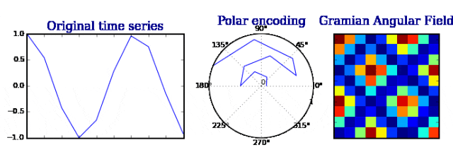
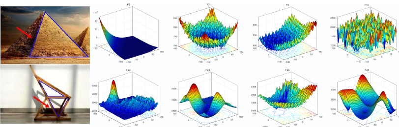
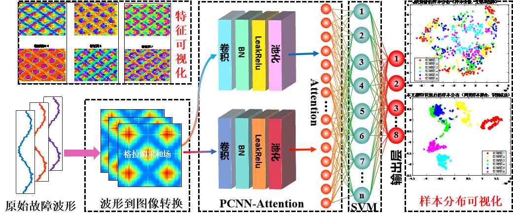
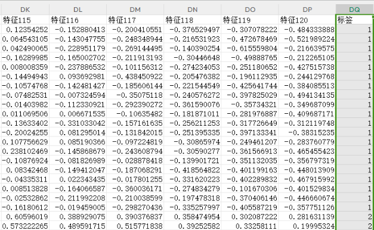
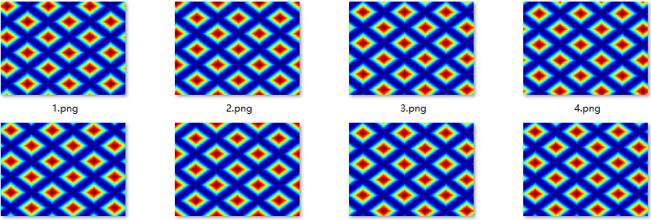
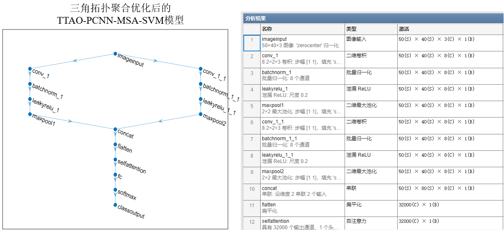
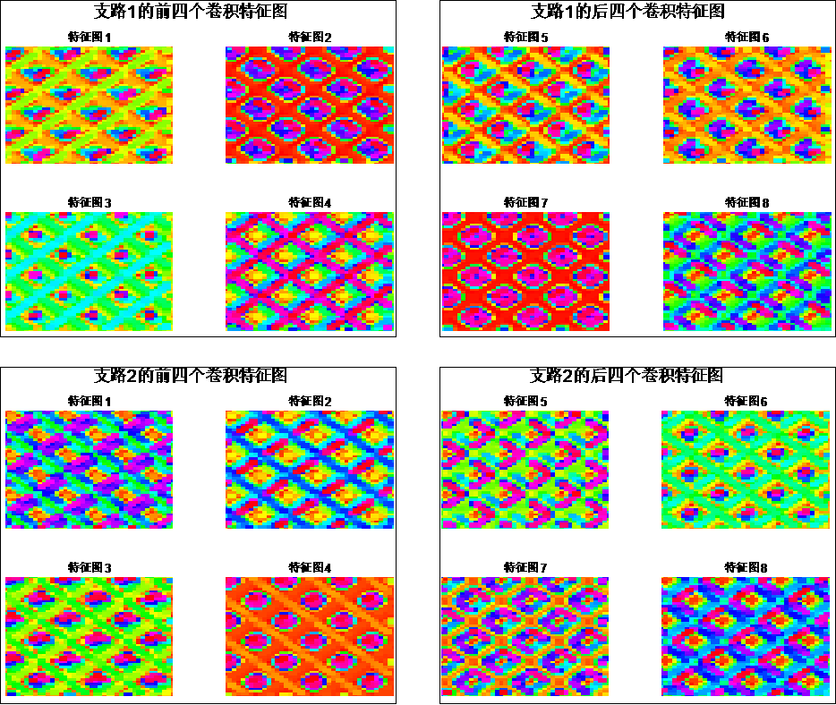
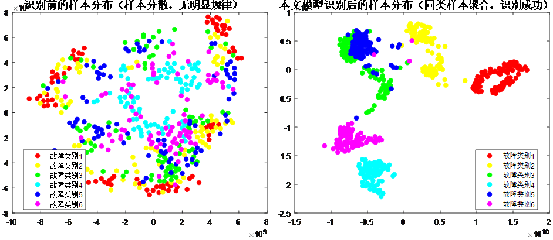
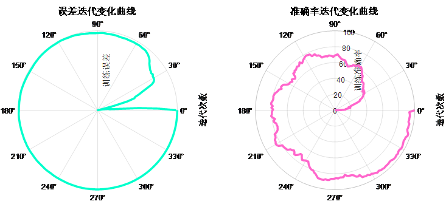
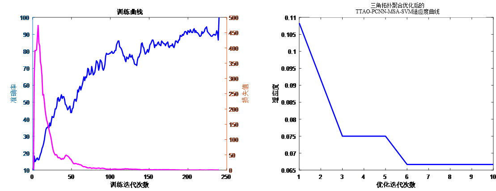
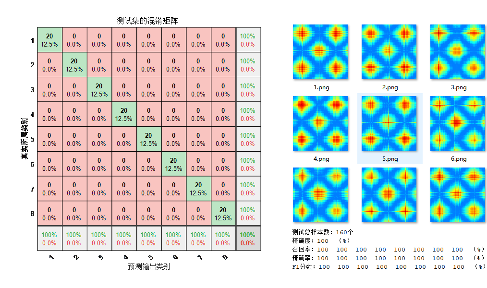

<!-- PAYMENT_BLOCK -->

## Get this dataset

- Payment link (Stripe): [Buy now](https://buy.stripe.com/3cs8yP7sY87d0vu9AB)
- Payment QR code: 

<!-- /PAYMENT_BLOCK -->
